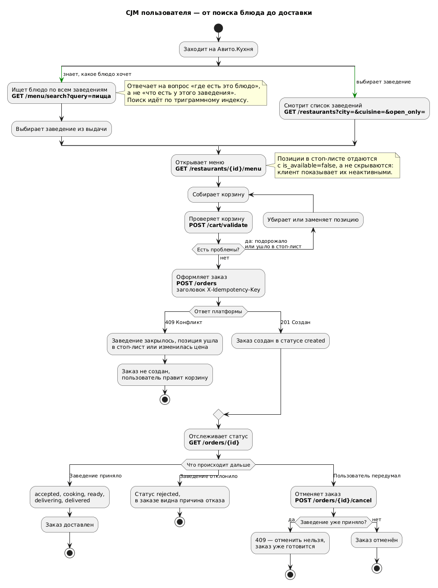
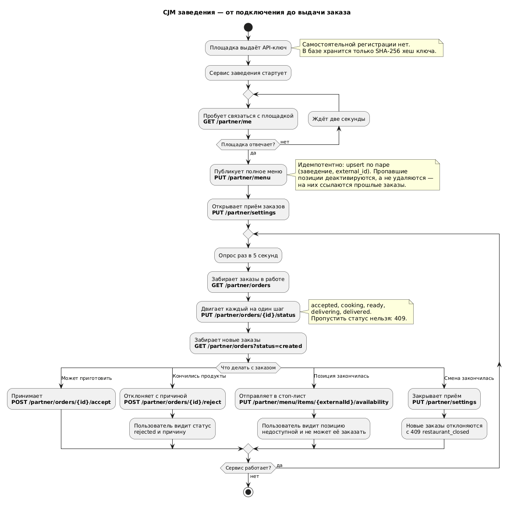
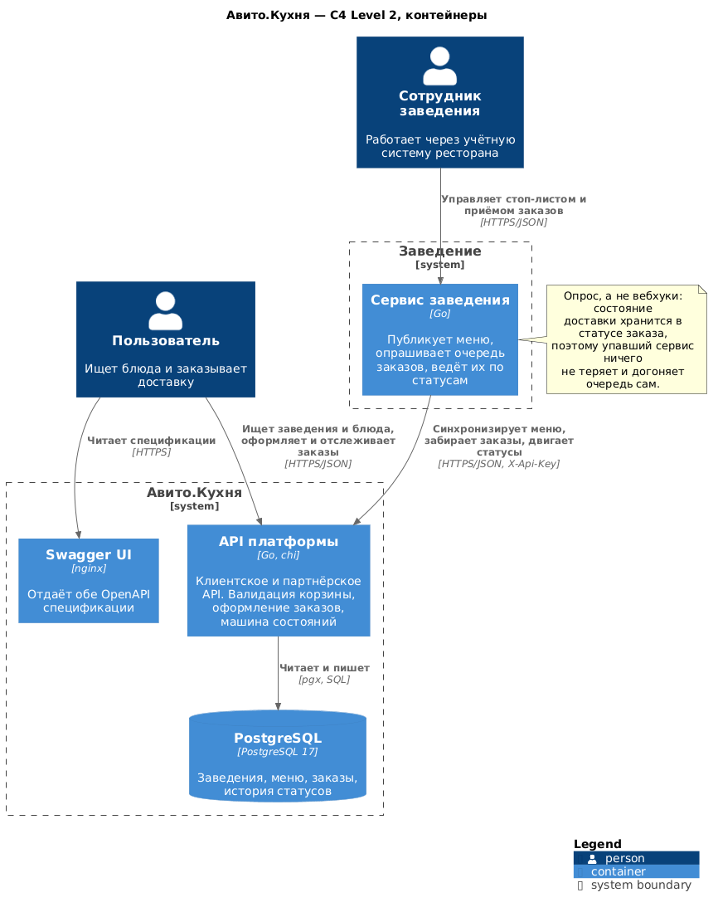
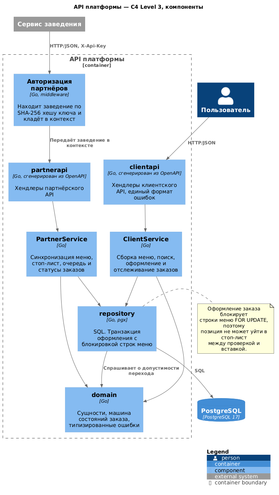
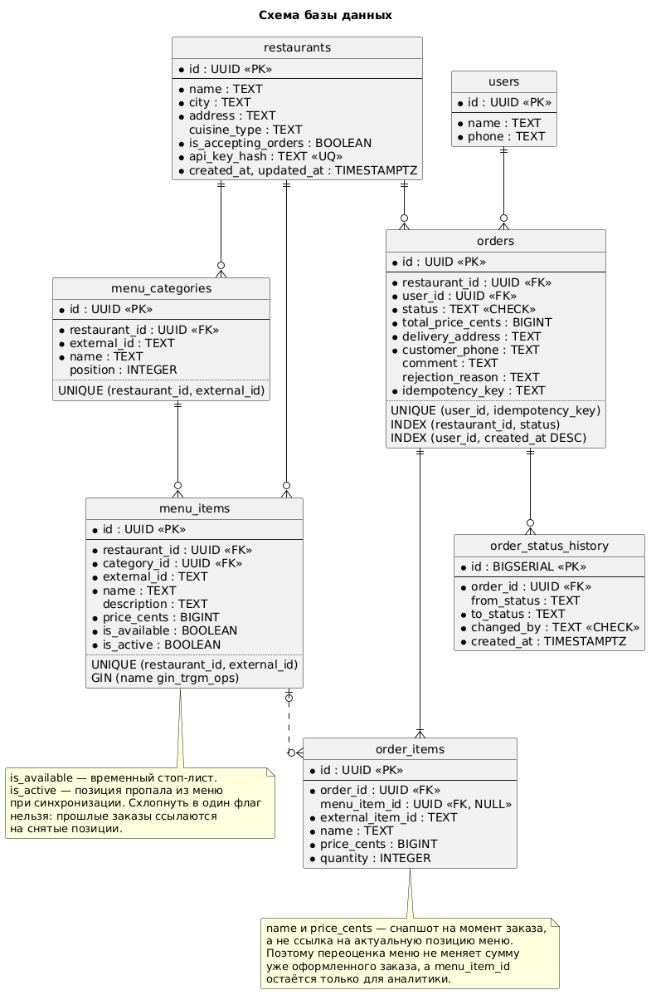

# Авито.Кухня

MVP сервиса доставки еды. Платформа предоставляет два API: клиентское — для поиска заведений и блюд, оформления и отслеживания заказов, и партнёрское — закрытое, для заведений, размещённых на площадке.

Вместе с платформой поднимается отдельный сервис-заведение «Пиццерия Мама Мия». Он работает автономно: публикует меню, опрашивает очередь заказов, принимает их и ведёт по статусам. Это одновременно демонстрация интеграции и способ показать проблемные сценарии — стоп-лист, отказ заведения, закрытый приём заказов.

Акцент сделан не на количестве эндпоинтов, а на местах, где данные могут разъехаться: снапшот цен в заказе, идемпотентность оформления, транзакция с блокировкой строк и явная машина состояний.

## Запуск

```bash
make up
```

Одна команда: собирает образы, поднимает PostgreSQL, накатывает миграции с демо-данными, стартует платформу, сервис-заведение и Swagger UI. Нужен только запущенный Docker.

```bash
make demo
```

Прогоняет все бизнес-сценарии по живому API и печатает результат. Требует `curl` и `jq`.

| Порт | Что |
|---|---|
| 8080 | API платформы |
| 8081 | Управляющее API сервиса-заведения |
| 8082 | Swagger UI с обеими спецификациями |
| 5433 | PostgreSQL (5432 обычно занят локальной базой) |

Демо-данные: два заведения, семь позиций меню, два пользователя.

| Что | Значение |
|---|---|
| Пиццерия Мама Мия | `11111111-1111-1111-1111-111111111111`, ключ `demo-restaurant-key` |
| Суши Волна | `11111111-1111-1111-1111-222222222222`, ключ `demo-sushi-key` |
| Пользователь Иван | `41111111-1111-1111-1111-111111111111` |

```bash
curl "localhost:8080/menu/search?query=Пицца" | jq
curl localhost:8080/partner/me -H "X-Api-Key: demo-restaurant-key" | jq
```

## Бизнес-сценарии

### Пользователь



Ключевой вопрос — как человек находит товар. Предусмотрены два входа: поиск блюда по всем заведениям (`GET /menu/search`, триграммный индекс) и выбор заведения из списка с фильтрами. Первый отвечает на вопрос «где есть эта пицца», второй — «что есть у этого ресторана».

Трудности, с которыми сталкивается пользователь, реализованы, а не только описаны: позиция ушла в стоп-лист, пока собиралась корзина; цена изменилась; заведение закрылось; заведение отклонило заказ. Каждая возвращает `409` с машиночитаемым описанием проблемы. Чтобы узнать о проблеме заранее, есть `POST /cart/validate` — та же валидация, что при оформлении, но без создания заказа.

### Заведение



Заведение получает ключ от площадки, публикует меню, открывает приём заказов и дальше опрашивает очередь. Меню синхронизируется целиком и идемпотентно: upsert по паре `(заведение, external_id)`, пропавшие позиции деактивируются.

### Статусы заказа

Переходы валидируются в одном месте, в доменном слое. Пропустить статус, вернуться назад или сменить статус не с той стороны нельзя.

| Из | В | Кто |
|---|---|---|
| `created` | `accepted` | заведение |
| `created` | `rejected` | заведение |
| `created` | `cancelled` | пользователь |
| `accepted` | `cooking` | заведение |
| `accepted` | `rejected` | заведение |
| `cooking` | `ready` | заведение |
| `ready` | `delivering` | заведение |
| `delivering` | `delivered` | заведение |

`delivered`, `rejected` и `cancelled` — терминальные. Отменить заказ можно только до принятия заведением.

## Архитектура

### Контейнеры (C4 Level 2)



Сервис-заведение узнаёт о новых заказах опросом, а не через вебхуки. Состояние доставки хранится в статусе заказа в БД платформы, а не в очереди сообщений, поэтому механизм самовосстанавливающийся: сервис заведения может упасть и не потерять ни одного заказа — он догонит очередь при следующем опросе. Вебхуки дали бы меньшую задержку, но потребовали бы transactional outbox, ретраев, подписи запросов и идемпотентности на приёмнике. Для MVP с одним заведением это неоправданная сложность; путь развития описан в разделе «Масштабирование».

### Компоненты платформы (C4 Level 3)



Слои разделены: транспорт не содержит бизнес-логики, репозиторий не решает, что можно делать с заказом — он спрашивает домен. Хендлеры обоих API сгенерированы из OpenAPI-спецификаций, поэтому не могут разойтись с документацией.

## Схема базы данных



| Таблица | Назначение |
|---|---|
| `restaurants` | Заведения, флаг приёма заказов, SHA-256 хеш API-ключа |
| `menu_categories` | Категории меню, адресуются `external_id` заведения |
| `menu_items` | Позиции меню, цена, стоп-лист |
| `users` | Владельцы заказов |
| `orders` | Заказы, статус, снапшот адреса и телефона, ключ идемпотентности |
| `order_items` | Состав заказа со снапшотом названия и цены |
| `order_status_history` | Аудит переходов: откуда, куда, кто и когда |

Принятые решения:

**Деньги хранятся целым числом копеек.** Числа с плавающей точкой для денег некорректны по определению, а `NUMERIC` неудобен в Go — нативного decimal-типа нет, пришлось бы тянуть библиотеку. Целые копейки закрывают вопрос без зависимостей.

**Состав заказа — снапшот, а не ссылки.** `order_items` хранит название и цену на момент оформления. Иначе заведение поднимет цену, и сумма уже доставленного заказа изменится задним числом. Ссылка на позицию меню остаётся, но только для аналитики и допускает `NULL`.

**Статус — `TEXT` с `CHECK`, а не `ENUM`.** Добавить значение в `ENUM` можно только через `ALTER TYPE`, который нельзя откатить в транзакции. `CHECK` меняется обычной миграцией.

**Первичные ключи — UUID.** Идентификаторы заказов уходят наружу; последовательные ключи позволяли бы перебирать чужие заказы. Для продакшена предпочтителен UUIDv7 — он монотонный и не разносит B-tree случайными вставками, в отличие от v4.

**У позиции меню два независимых флага.** `is_available` — временный стоп-лист, `is_active` — позиция пропала из меню при синхронизации. Схлопнуть в один нельзя: прошлые заказы должны продолжать ссылаться на снятые позиции.

**Связь с учётной системой заведения — через `external_id`.** Заведение работает в своих идентификаторах, платформа сопоставляет их со своими по уникальной паре `(restaurant_id, external_id)`. В заказе, который забирает заведение, едут оба идентификатора.

**Индексы:** `orders(restaurant_id, status)` — под опрос очереди заведением, `orders(user_id, created_at DESC)` — под историю заказов, GIN с `pg_trgm` на `menu_items.name` — под поиск блюда по всем заведениям.

## API

Спецификации: [`api/openapi.yaml`](api/openapi.yaml) — клиентское, [`api/partner-openapi.yaml`](api/partner-openapi.yaml) — партнёрское. Обе открываются в Swagger UI на `localhost:8082`.

Спецификация — источник истины: код сервера генерируется из неё через `oapi-codegen`, а сервис-заведение ходит в платформу клиентом, сгенерированным из того же файла. Разойтись они не могут — сборка сломается.

**Клиентское API.** Список и поиск заведений, карточка, меню, поиск блюда по всем заведениям, проверка корзины, оформление, история заказов, статус, отмена.

**Партнёрское API.** Профиль, открытие и закрытие приёма заказов, синхронизация меню, стоп-лист, очередь заказов, принятие, отклонение с причиной, продвижение статусов.

Аутентификация заведений — заголовок `X-Api-Key`; в базе хранится только SHA-256 хеш, дамп базы не выдаёт рабочие ключи. Заведение резолвится в middleware и передаётся в контексте, поэтому хендлер не принимает идентификатор заведения из запроса — обратиться к чужим данным нельзя по построению.

Аутентификация пользователей по условию задания не реализуется. Пользователь передаётся заголовком `X-User-Id`, которому сервер доверяет. Это единственное место, которое меняется при внедрении JWT; контракты хендлеров при этом не затрагиваются.

## Принятые упрощения

Задание допускает упрощения при условии, что они обоснованы. Осознанно не реализовано:

| Что | Почему |
|---|---|
| Оплата | Вне продуктового скоупа MVP, не влияет на проектирование остальной системы |
| Курьеры и логистика доставки | Отдельный домен со своей моделью; заказ доводится до статуса `delivered` заведением |
| Аутентификация пользователей | Прямо исключена условием задания |
| Отзывы, рейтинги, промокоды | Не отвечают на вопрос, как человек находит товар |
| Вебхуки вместо опроса | См. раздел «Масштабирование» |
| Расписание работы заведения | Часовые пояса, праздники и смены через полночь стоят дорого и ничего не добавляют к сценариям. Заведение открывает и закрывает приём вручную |
| Серверная корзина | Корзина не источник истины: цены и доступность всё равно проверяются при оформлении. Отдельная таблица и четыре эндпоинта не убрали бы ни одной проверки |

Демо-данные загружаются миграцией `00002_seed_demo_data.sql`. Строго говоря, это не место для демо-данных, но так `make up` одной командой даёт систему, готовую отработать все сценарии. В продакшене это был бы отдельный шаг.

## Масштабирование

**Опрос упирается в число заведений.** При 10 000 заведений с интервалом 5 секунд платформа получает около 2000 холостых запросов в секунду. Порядок развития: опрос → вебхуки через transactional outbox (событие пишется в одной транзакции с заказом, отдельный воркер доставляет его с ретраями, доставка становится at-least-once, поэтому приёмник обязан быть идемпотентным) → брокер сообщений с consumer group.

**Чтение отделяется от записи.** Поиск блюд и списки заведений — самые частые запросы и при этом не требуют строгой консистентности. Первый шаг — реплики на чтение, дальше вынос поиска в отдельное хранилище.

**Блокировка строк меню — точка сериализации.** Оформление заказа блокирует позиции `FOR UPDATE`. При высокой конкуренции за одно популярное блюдо это становится узким местом. Строки блокируются в порядке идентификаторов, что исключает взаимные блокировки, но не устраняет ожидание.

**Пагинация по смещению деградирует.** `LIMIT/OFFSET` приемлем для MVP, но на больших списках заменяется на курсорную.

**Заказы растут быстрее всего.** Естественный ключ секционирования — дата создания, с переносом закрытых заказов в холодное хранилище.

### Измеренная нагрузка

Замеры сделаны на синтетическом наборе: 1000 заведений, 5000 категорий, 30 000 позиций меню, 50 000 заказов, 100 000 позиций в заказах — база 60 МБ. Всё крутится в Docker Desktop на ноутбуке, один экземпляр API, поэтому цифры показывают порядок и соотношения, а не предел системы.

| Сценарий | RPS | p50 | p99 |
|---|---|---|---|
| Список заведений с фильтрами | 7 274 | 6 мс | 26 мс |
| Меню заведения | 5 888 | 8 мс | 15 мс |
| Поиск блюда, редкий запрос | 13 919 | 3 мс | 6 мс |
| Поиск блюда, 5000 совпадений | 345 | 141 мс | 179 мс |
| Оформление заказа, разные заведения | 2 705 | 18 мс | 36 мс |
| Оформление заказа, одна и та же позиция | 1 595 | 31 мс | 44 мс |

Чтение — 3000 запросов при конкурентности 50 (ApacheBench), запись — 3000 заказов при конкурентности 50, ошибок и потерянных обновлений нет ни в одном прогоне.

**Блокировка строк стоит около 40% пропускной способности при худшем сценарии.** Когда все 50 параллельных заказов конкурируют за одну позицию меню, `FOR UPDATE` сериализует их: 1 595 против 2 705 заказов в секунду. Это осознанная цена: без блокировки цифра была бы выше, но заказы создавались бы по устаревшему чтению — тест `TestPlaceOrderBlocksOnTheMenuRowLock` показывает это напрямую.

**Узкое место поиска — ранжирование, а не индекс.** Триграммный GIN отрабатывает мгновенно: редкий запрос даёт 13 919 rps. Но `ORDER BY similarity(name, query)` вычисляет similarity для каждого совпадения и сортирует их целиком, поэтому запрос, под который подходит шестая часть каталога, падает до 345 rps. `EXPLAIN` подтверждает: индекс используется (`Bitmap Index Scan on menu_items_name_trgm_idx`), время уходит в `Sort`. Синтетические данные здесь пессимистичны — в них всего 15 шаблонов названий на 30 000 позиций, в реальном каталоге совпадений на порядок меньше. Тем не менее ограничение реальное: лечится отсечением кандидатов до ранжирования (`name % query` с порогом `pg_trgm.similarity_threshold`) или выносом поиска в отдельный индекс.

## Разработка

```bash
make help      # список целей
make test      # юнит-тесты и интеграционные на testcontainers
make lint      # golangci-lint, конфигурация в .golangci.yml
make generate  # перегенерировать код из OpenAPI
make diagrams  # перерисовать диаграммы
make logs      # логи платформы и заведения
```

Тесты покрывают то, что заявлено в архитектуре. Машина состояний проверена таблично. Транзакционная блокировка проверяется детерминированно: тест сам удерживает строку меню, убеждается, что оформление заблокировано, затем отправляет позицию в стоп-лист и отпускает блокировку — оформление обязано завершиться отказом. Без `FOR UPDATE` этот тест падает. Идемпотентность проверяется двенадцатью одновременными одинаковыми запросами: должен появиться ровно один заказ.

Интеграционные тесты поднимают PostgreSQL через testcontainers и накатывают настоящий файл миграции, а не копию схемы. Если Docker недоступен, они пропускаются, а не падают.

Статический анализ: `golangci-lint`, шестнадцать активных линтеров, включая проверки утечек ресурсов при работе с HTTP и SQL (`bodyclose`, `sqlclosecheck`, `rowserrcheck`, `noctx`) и корректности обработки ошибок (`errorlint`, `nilerr`).

## Структура репозитория

```
api/                     OpenAPI спецификации и конфигурация кодогенерации
cmd/api/                 платформа
cmd/restaurant/          сервис-заведение
internal/platform/       домен, репозитории, сервисы, транспорт платформы
internal/restaurant/     логика заведения и сгенерированный клиент платформы
internal/pkg/            конфигурация, логирование, хеширование ключей
migrations/              миграции goose
docs/diagrams/           исходники PlantUML и отрисованные диаграммы
scripts/demo.sh          прогон бизнес-сценариев
```
